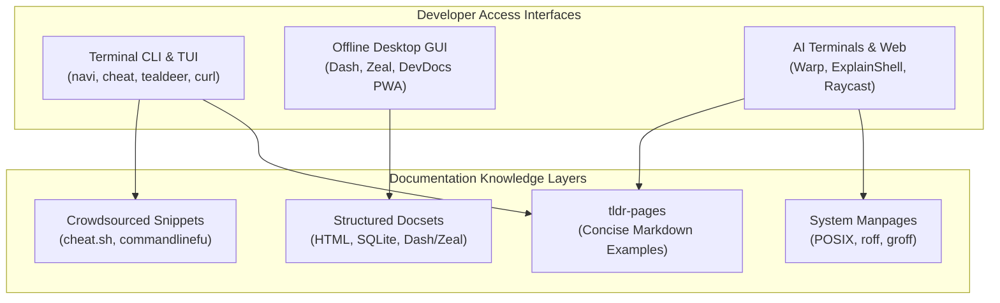

  

# 🚀 Awesome CLI Documentation & Cheatsheets Ecosystem

> 📚 A comprehensive, SEO-optimized, curated guide to CLI documentation tools, interactive cheatsheet managers, simplified man pages, offline documentation browsers, and developer productivity launchers.

📅 Last updated: October 2026

---

## 📑 Table of Contents

- [📊 Sector Overview & Market Dynamics](#-sector-overview--market-dynamics)
- [☁️ SaaS & Hosted Platforms](#️-saas--hosted-platforms)
- [💻 Open-Source GitHub Projects](#-open-source-github-projects)
  - [⭐ Primary Category Leaders](#-primary-category-leaders)
  - [⚡ Interactive TUI & CLI Cheatsheet Managers](#-interactive-tui--cli-cheatsheet-managers)
- [🏗️ Architecture & Stack Comparison](#️-architecture--stack-comparison)
- [🎯 How to Choose the Right Tool](#-how-to-choose-the-right-tool)
- [🤝 How to Contribute](#-how-to-contribute)
- [🌟 Star History](#-star-history)
- [💖 Support](#-support)
- [⚖️ Disclaimer & Best Practices](#️-disclaimer--best-practices)

---

## 📊 Sector Overview & Market Dynamics

The developer documentation and CLI cheatsheets domain represents a critical sub-segment of the broader developer tooling and productivity software market, currently estimated at **$1.8B to $2.2B** globally with an accelerating CAGR of ~16.5% powered by AI terminal assistants. The ecosystem exhibits **moderate-to-high fragmentation** at the lookup and reference level (divided among community-maintained Markdown pages, local SQLite-backed docsets, and terminal curl interfaces), but transitions toward **winner-take-most concentration** in modern GPU-accelerated and AI-native terminal workflows where deep ecosystem integration and network effects dominate developer workstations.

---

## ☁️ SaaS & Hosted Platforms

| Product | Valuation / Revenue | Starting Price | Free Tier Limits | Key Highlights & Description |
| :--- | :--- | :--- | :--- | :--- |
| **[Warp](https://www.warp.dev/)** | **~$200M Valuation** ($73M+ VC raised) | **$18/user/month** (Build tier, billed annually) | **100% Free forever** for individuals (includes full core terminal, Warp Drive workflows, and base Warp Agent CLI) | Modern Rust-based, GPU-accelerated terminal with built-in AI command search (`Cmd+Shift+K`), shared team workflows, and interactive parameter prompts. |
| **[Raycast](https://www.raycast.com/)** | **~$100M+ Valuation** (~$5M–$6M ARR) | **$8/month** (Pro tier, billed annually) | **100% Free forever** for individual local use (includes unlimited local snippets, script commands, community extensions, and window management; excludes cloud sync & AI) | Blazing-fast extensible desktop command palette with instant text-expansion snippets, community cheatsheet extensions, and unified developer actions. |
| **[Dash](https://kapeli.com/dash)** | **~$500K–$1M ARR** (Bootstrapped / Indie) | **$2.35/month** (~$28/year subscription for macOS) | **Unregistered free trial** with no time expiration (all features and 200+ offline docsets accessible; displays periodic reminder nags with slight delay popups) | The gold-standard offline documentation browser and snippet manager for macOS, supporting 200+ offline API docsets with fuzzy search and IDE integrations. |
| **[DevDocs](https://devdocs.io/)** | **Non-Profit / Open Web** (Supported by freeCodeCamp) | **Free** ($0) | **100% Free forever** with no limits (PWA offline caching for 100+ documentation sets; no accounts or paid upgrades required) | Fast, centralized web and offline documentation aggregator combining 100+ language/framework manuals into a unified, instant-search interface. |
| **[ExplainShell](https://explainshell.com/)** | **Indie Project** ($0 commercialization) | **Free** ($0) | **100% Free forever** with no limits (Web-based parser with complete access to man page argument breakdowns) | Interactive visual shell command analyzer that dissects complex command strings into AST tokens and displays matching man page flag definitions. |
| **[Command-line-fu](https://www.commandlinefu.com/)** | **Community Platform** ($0 commercialization) | **Free** ($0) | **100% Free forever** with no limits (Unlimited search, browsing, and community voting for command-line one-liners) | Crowd-voted community repository of real-world shell one-liners, terminal commands, and command-line tips categorized by tag and upvote score. |

---

## 💻 Open-Source GitHub Projects

All open-source repositories below are sorted in **descending order by GitHub stargazers count** and feature social badge counters linking directly to each project's stargazers community.

### ⭐ Primary Category Leaders

- **[tiimgreen/github-cheat-sheet](https://github.com/tiimgreen/github-cheat-sheet)**   
  *A comprehensive, multi-language guide of tips, tricks, and hidden features for Git and GitHub.* Features in-depth shortcuts for git CLI revisions, rebasing, stash tricks, submodule handling, and GitHub search syntaxes.

- **[tldr-pages/tldr](https://github.com/tldr-pages/tldr)**   
  *Collaborative, community-driven cheatsheets for command-line tools.* The de-facto standard complement to dense man pages, providing practical, real-world examples for thousands of commands across Linux, macOS, Windows, and FreeBSD. Supported by native clients across Rust, Python, Go, and web PWAs.

- **[chubin/cheat.sh](https://github.com/chubin/cheat.sh)**   
  *The only cheatsheet you need — accessible via plain curl.* Zero-installation cheatsheet service aggregating tldr-pages, StackOverflow, and specialized community sheets covering 56+ programming languages and hundreds of UNIX utilities (`curl cht.sh/tar`).

- **[freeCodeCamp/devdocs](https://github.com/freeCodeCamp/devdocs)**   
  *All-in-one API documentation environment with offline PWA support.* Integrates official documentation sets for major programming languages, web APIs, and frameworks into a fast, keyboard-navigable desktop and mobile interface.

- **[alebcay/awesome-shell](https://github.com/alebcay/awesome-shell)**   
  *Curated collection of command-line frameworks, shells, documentation utilities, and terminal productivity tools.* Provides an extensive directory of command-line productivity enhancements.

- **[denisidoro/navi](https://github.com/denisidoro/navi)**   
  *Interactive cheatsheet tool with fuzzy auto-completion and parameter suggestions.* Written in Rust, navi prompts for command parameters dynamically from custom or cheat.sh repositories, saving developers from manually copying parameters or memorizing complex syntax.

- **[idank/explainshell](https://github.com/idank/explainshell)**   
  *Live web application that parses shell commands into AST tokens and highlights manpage matches.* Breaks down complex shell incantations (arguments, flags, redirections) and presents individual manual explanations.

- **[cheat/cheat](https://github.com/cheat/cheat)**   
  *Create and view interactive cheatsheets directly in your terminal.* Tailored for system administrators and DevOps engineers to manage private, team, and community cheatsheets in plain text with fuzzy search via fzf.

- **[zealdocs/zeal](https://github.com/zealdocs/zeal)**   
  *Offline documentation browser for Linux and Windows inspired by Dash.* Connects to 200+ Dash-compatible docsets with zero internet dependency, fast symbol search, and editor integrations (Vim, Emacs, VS Code).

- **[skywind3000/awesome-cheatsheets](https://github.com/skywind3000/awesome-cheatsheets)**   
  *Curated quick reference sheets for developers, database architects, and sysadmins.* Comprehensive cheat sheets covering Bash, Git, Python, VIM, tmux, gdb, regex, and network diagnostics.

- **[Idnan/bash-guide](https://github.com/Idnan/bash-guide)**   
  *Comprehensive guide to mastering the Bash command line.* Covers core shell patterns, parameter expansions, flow controls, and essential CLI commands with syntax references.

- **[tealdeer-rs/tealdeer](https://github.com/tealdeer-rs/tealdeer)**   
  *Blazing fast implementation of tldr in Rust.* Fetches and caches tldr pages locally with millisecond lookup speeds, syntax coloring, and automatic background cache updates.

- **[gnebbia/kb](https://github.com/gnebbia/kb)**   
  *Minimalist command-line knowledge base manager.* Designed to collect, organize, and search personal cheatsheets, procedures, code snippets, and operational runbooks directly in the terminal.

- **[srsudar/eg](https://github.com/srsudar/eg)**   
  *Practical command-line examples with clear explanations.* Complements man pages with user-tested command examples and inline annotations.

- **[isacikgoz/tldr](https://github.com/isacikgoz/tldr)**   
  *Interactive command-line client for tldr written in Go.* Supports interactive fuzzy matching and direct command execution from the tldr prompt.

- **[tldr-pages/tlrc](https://github.com/tldr-pages/tlrc)**   
  *Official client specification for tldr in Rust.* Standard reference client maintaining strict POSIX and cross-platform compatibility.

- **[filiparag/wikiman](https://github.com/filiparag/wikiman)**   
  *Universal offline documentation search engine.* Unifies manual pages, tldr-pages, ArchWiki, Gentoo Wiki, and FreeBSD docs into a unified TUI search with fuzzy matching.

- **[halilkirazkaya/arsenal-ng](https://github.com/halilkirazkaya/arsenal-ng)**   
  *Modern security & pentest command launcher with cheatsheet manager.* Features 150+ categorized cybersecurity cheatsheets with an interactive fuzzy TUI.

- **[hubsmoke/bro](https://github.com/hubsmoke/bro)**   
  *Historical crowdsourced command examples utility.* The foundational project that inspired modern crowdsourced help pages (now archived; historically significant).

---

### ⚡ Interactive TUI & CLI Cheatsheet Managers

| Tool | Ecosystem / Language | Primary Interface | Offline Capable | Best Used For |
| :--- | :--- | :--- | :--- | :--- |
| **[navi](https://github.com/denisidoro/navi)** | Rust | Terminal Interactive TUI / fzf | Yes | Interactive command composition with argument placeholders |
| **[cheat](https://github.com/cheat/cheat)** | Go | Terminal CLI & fzf | Yes | Team-shared private cheatsheets with multiple cheatpaths |
| **[tealdeer](https://github.com/tealdeer-rs/tealdeer)** | Rust | Terminal CLI | Yes (Local cache) | Instant sub-millisecond tldr lookup |
| **[wikiman](https://github.com/filiparag/wikiman)** | C / Shell | Terminal TUI | Yes | Unified offline search across man, tldr, and Linux distros |
| **[arsenal-ng](https://github.com/halilkirazkaya/arsenal-ng)** | Python | Terminal TUI | Yes | Cybersecurity, CTF, and penetration testing payloads |

---

## 🏗️ Architecture & Stack Comparison

---

## 🎯 How to Choose the Right Tool

- 🔍 **For immediate syntax recall without installation**: Run `curl cht.sh/<command>` in any terminal.
- ⚡ **For fast, human-readable everyday command examples**: Install `tealdeer` (`tldr`) via your system package manager.
- 🛠️ **For interactive command building with parameter auto-completion**: Use `navi` configured with your shell hooks (`Ctrl+G`).
- 📖 **For offline documentation without an active internet connection**: Use **Zeal** (Linux/Windows) or **Dash** (macOS).
- 👥 **For corporate or team-internal cheatsheet repositories**: Deploy `cheat` with shared Git cheatpaths.
- 💡 **For learning what a complex multi-pipe one-liner does**: Paste the command into **ExplainShell**.

---

## 🤝 How to Contribute

Contributions are welcome! To add or update an entry:

1. 🍴 Fork this repository.
2. 🔍 Verify that open-source entries include their repository URL and Stars_Counter badge.
3. 🏷️ Verify that SaaS products include specific starting tier pricing, free tier limits, and valuation/revenue context.
4. 📝 Keep entries concise, objective, and alphabetized or star-sorted within their respective sections.
5. 🚀 Submit a pull request with a descriptive title and summary.

---

## 🌟 Star History

---

## 💖 Support

Thank you so much for exploring and using **Awesome CLI Documentation & Cheatsheets**! 🙏

If you find this repository helpful, please consider supporting the project:
- ⭐ **Star** this repository on GitHub to help others discover it.
- 🍴 **Fork** and contribute your favorite CLI tools and cheatsheets.
- 📢 **Share** it with your developer friends, teams, and communities.
- ☕ **Buy Me a Coffee / Sponsor**: Support ongoing maintenance and curation on the [GitHub Sponsors Dashboard](https://github.com/sponsors/ishandutta2007).

---

## ⚖️ Disclaimer & Best Practices

- 📌 This repository is a community-maintained curated guide and does not constitute an endorsement of any commercial platform.
- ⚠️ When running commands retrieved from online cheatsheets, verify that arguments (especially flags related to recursive deletion, privilege escalation, or disk writing like `rm -rf`, `dd`, or `chmod -R`) are safe for your environment.
- 💡 Cheatsheet tools are complementary: use `tldr` or `cheat.sh` for quick practical patterns, and consult primary `man` pages or official vendor documentation for definitive edge-case behaviors.

---

  Maintained with ❤️ by <a href="https://github.com/ishandutta2007">Ishan Dutta</a> and community contributors.

